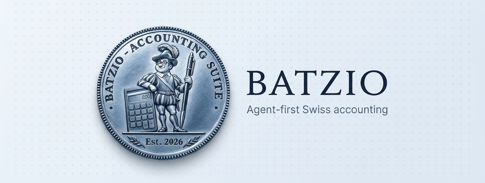
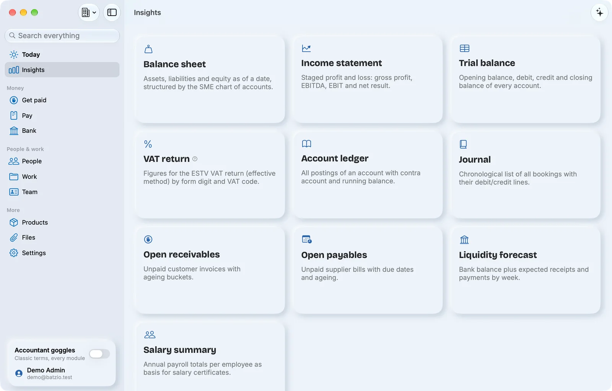
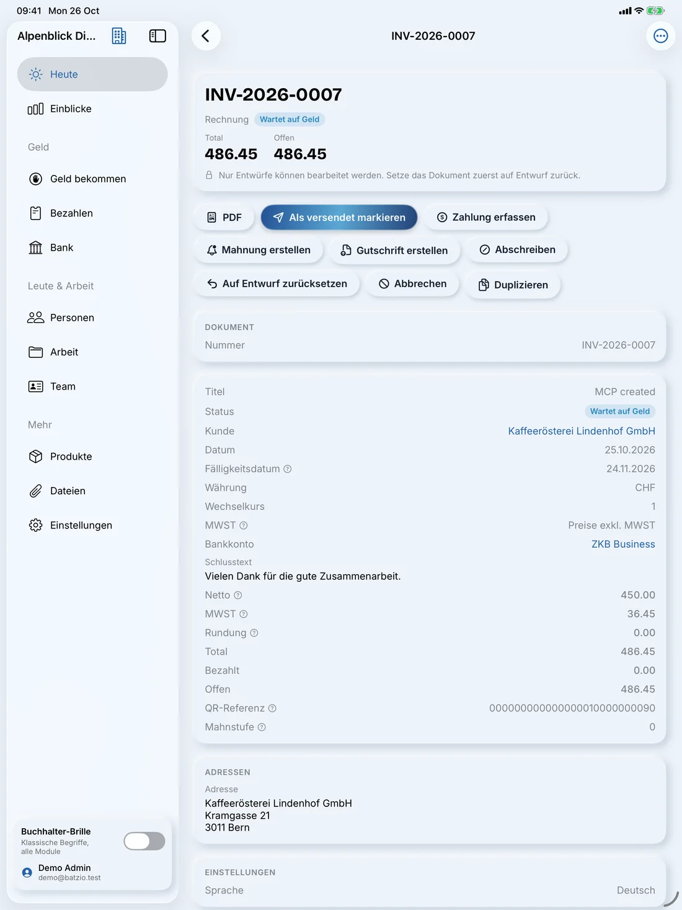
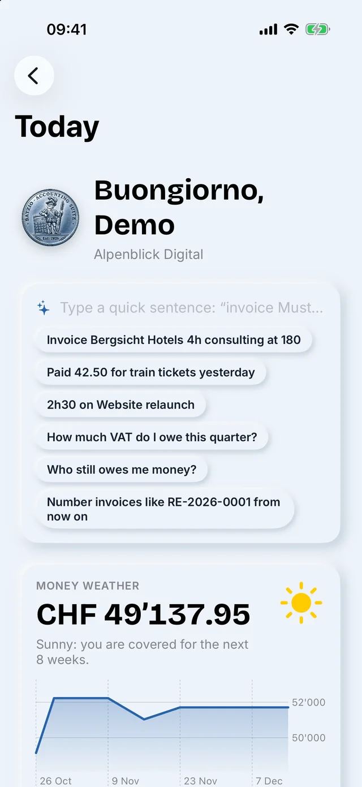
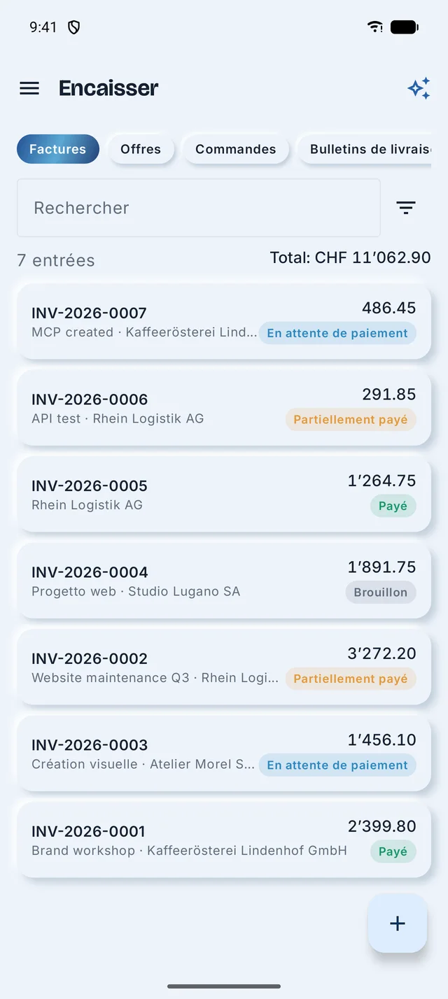
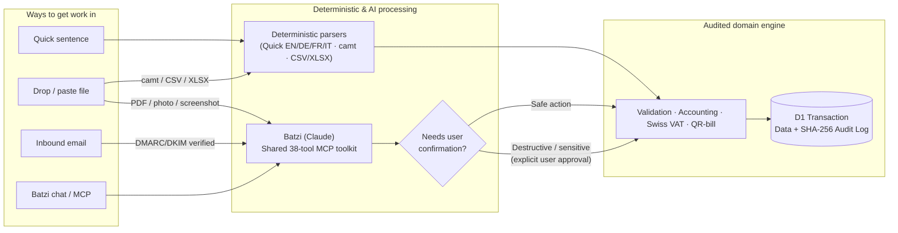
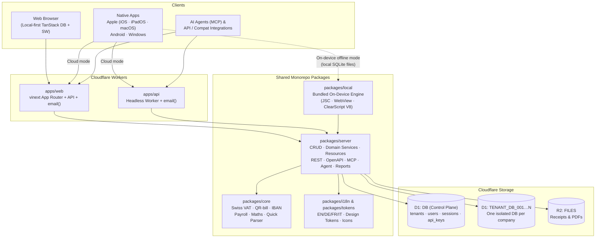
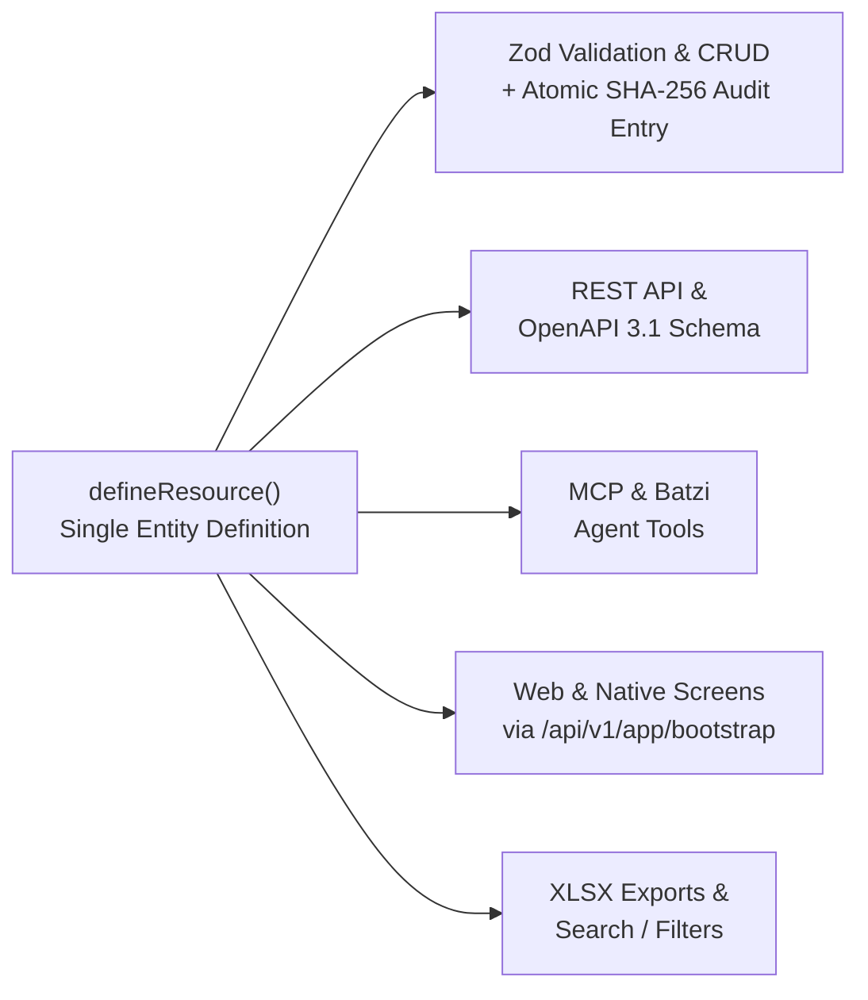

<p align="center">
  
</p>

# Batzio

*Accounting, Sweet!* — **Agent-first, open-source Swiss business and accounting software** for people who would rather spend their time on something other than accounting.

Drop a supplier bill, paste a screenshot, forward an email, or type one plain sentence, and **Batzi** (a Claude-powered bookkeeper) handles the entry. Underneath sits a complete Swiss SME accounting suite: contacts, quotes → orders → delivery notes → invoices with Swiss QR-bill, purchasing, full double-entry ledger with Swiss VAT, banking (`camt`/`pain`), projects and time tracking, and payroll — with a REST API, OpenAPI 3.1 docs, an MCP server, and a drop-in compatibility API.

Built with **vinext** (Next.js App Router on Vite) on **Cloudflare Workers**, **[ui-sdk](https://ui-sdk.dev)** (headless React components, styled with Tailwind), and **one Cloudflare D1 database per company** — plus native apps for **iPhone, iPad, and Mac** (SwiftUI), **Android** (Jetpack Compose), and **Windows** (WinUI 3), all driven from the same entity definitions, translations, and design tokens.

Open source under the [GNU AGPL v3.0](LICENSE) · Hosted demo at [www.batzio.ch](https://www.batzio.ch).

> [!WARNING]
> **Disclaimer — Experimental Software**
>
> Batzio is an experimental ("vibe-coded") project and is **not** audited, certified, or legally vetted accounting, tax, or payroll software. **Do not rely on it for real company books, VAT filings, payroll declarations, or legal compliance** without independent verification by a qualified Swiss accountant (*Treuhänder* / *fiduciaire*).
>
> AI-assisted actions (Batzi) can make mistakes and must be reviewed. This software is provided **"AS IS"** without warranty of any kind under the [GNU AGPL v3.0](LICENSE); the authors accept no liability for financial, tax, or legal consequences arising from its use.

---

## Screenshots

<p align="center">
  <a href="apps/web/public/marketing/mac-insights.webp"></a>&nbsp;
  <a href="apps/web/public/marketing/ipad-invoice.webp"></a>&nbsp;
  <a href="apps/web/public/marketing/iphone-today.webp"></a>&nbsp;
  <a href="apps/web/public/marketing/android-invoices.webp"></a>
</p>
<p align="center">
  <sub>macOS (Insights) · iPadOS (Invoice, DE) · iOS (Today &amp; Money Weather) · Android (Invoices, FR) — click any screenshot to enlarge</sub>
</p>

---

## Design goals

1. **Agent-first, human-in-the-loop.** Every workflow in the UI is also a first-class tool for Batzi, external AI agents (via MCP), and deterministic quick sentences. Destructive or irreversible actions always pause for explicit confirmation, and untrusted inputs (uploaded files, external emails) are treated strictly as data, never instructions.
2. **Swiss-native without the jargon.** Built around Swiss SME standards — KMU chart of accounts, Swiss VAT (8.1% / 2.6% / 3.8%, ESTV form digits), QR-bills, ISO 20022 (`camt.052/053/054`, `pain.001.001.09`), and Swiss payroll (AHV/IV/EO, ALV, BVG, NBU, KTG) — in **English, Deutsch, Français, and Italiano**, with plain-language tooltips and an *"Accountant goggles"* toggle for classic terminology.
3. **Instant and local-first.** Web navigation targets 10–30 ms using hover/focus prefetching and IndexedDB-backed live lists (TanStack DB). Every native app can also run completely **on-device with no server or account**, executing the exact same TypeScript engine on local SQLite files.
4. **One definition, every surface.** Each business entity is defined once (`packages/server/src/resources/defs/*`) and automatically drives validation, persistence, audit logging, REST endpoints, OpenAPI 3.1, MCP tools, XLSX exports, web screens, and every schema-driven native app. Design tokens, icons, and translations are generated from a single source of truth (`pnpm gen`).
5. **Strict tenant isolation & tamper-evident history.** Every company gets its own isolated D1 SQLite database. Every mutation — from UI, API, MCP, Batzi, quick sentence, email, or import — is sealed into a SHA-256 hash-chained audit log in the same transaction, with readable before/after diffs, provenance tracking, safe undo, and 10-year retention locks (Art. 958f CO).
6. **Open and easy to switch into (or out of).** Self-hostable under AGPL-3.0, with a full REST API, MCP server, XLSX exports everywhere, a one-click migration importer, and a 310-operation compatibility API so existing Swiss accounting integrations keep working.

---

## Key features

| Area | What you get |
| --- | --- |
| **Batzi, the AI bookkeeper** | Chat panel everywhere (`⌘J`) and console on the Today page. Shares the MCP toolkit: create/issue invoices, book bills and receipts (with original attachments), import lists, update company/VAT/document settings, logo, and team invites. Destructive steps wait for a confirm button |
| **Drop anything & inbound email** | Drag or paste files anywhere, or forward bills to `<slug>.<token>@<EMAIL_DOMAIN>`: `camt` statements and CSV/XLSX tables import on the spot; PDFs, photos, and screenshots go to Batzi. Outside senders can only submit bills/receipts for review |
| **Quick sentences** | *"invoice Muster AG 3h consulting at 180"*, *"paid 42.50 for SBB tickets yesterday"*, *"2h30 on Website relaunch"*, *"Anna paid"* — parsed deterministically in EN/DE/FR/IT with a live preview, no AI required |
| **Today & A4 editor** | *"Needs you"* action cards, 8-week cash forecast (*Money weather*), and a live A4 document editor mirroring the PDF millimetre for millimetre (letterhead, window address, positions, totals, Swiss QR-bill) |
| **Languages & jargon** | Full UI and plain-language accounting tooltips in English, Deutsch, Français, and Italiano; *"Accountant goggles"* toggle between simple and classic terms |
| **Contacts, sales & invoicing** | Companies/persons with Swiss UID validation; quotes, orders (recurring billing), delivery notes, invoices, credit notes; Swiss QR-bill (QR-IBAN + QRR / IBAN + SCOR), multilingual PDFs, 5-Rappen rounding, Skonto, partial payments, 3-level dunning, bad-debt write-off |
| **Purchasing, accounting & VAT** | Supplier bills, purchase orders, expenses; Swiss KMU chart of accounts in 4 languages, automatic & compound entries, reversals, journal, ledgers, trial balance, staged income statement (gross profit I/II, EBITDA, EBIT, EBT), balance sheet, year-end closing, period locks, ESTV VAT return |
| **Banking, projects & payroll** | ISO 20022 `camt.052/053/054` & CSV import with auto-matching, `pain.001.001.09` export; projects, budgets, time tracking, one-click invoicing, inventory/stock; Swiss payroll (AHV/IV/EO, ALV, BVG, NBU, KTG, withholding tax, payslip PDFs, annual summary) |
| **Platform, offline & audit** | Multi-company roles, scoped API keys, SHA-256 hash-chained audit log with readable diffs, provenance & undo, duplicate detection, `Idempotency-Key` support, 10–30 ms local-first web lists, and full **on-device offline mode** on Apple, Android & Windows |
| **Integrations & migration** | REST API, generated **OpenAPI 3.1** (`/docs/api`), **MCP** server (`/api/mcp`), **Compatibility API** (`/api/compat`, 310 documented 2.0/3.0/4.0 operations), XLSX exports, and one-click *Settings → Move in* importer |

### How intake & automation work



---

## Running locally

### Prerequisites

* **Node.js 24+**
* **pnpm 12+** (`corepack enable` or `npm i -g pnpm`)
* Optional for native apps:
  * **Apple**: Xcode 26+ and [XcodeGen](https://github.com/yonaskolb/XcodeGen) (`brew install xcodegen`)
  * **Android**: JDK 21 and Android SDK (or Android Studio)
  * **Windows**: Windows 10 1809+ with .NET 10 SDK (or Visual Studio 2026 with WinUI workload); `Batzio.Core.Tests` runs on any OS with .NET 10

### 1. Install dependencies

```bash
git clone https://github.com/raphaelsaunier/batzio.ch.git
cd batzio.ch
pnpm install
```

### 2. Configure optional environment variables

Batzio works locally out of the box with zero configuration — Miniflare automatically simulates Cloudflare D1 and R2 in `.cloudflare/state`.

To enable **Batzi** (Claude), a one-click local demo login, or inbound email testing, copy the example file:

```bash
cp apps/web/.env.example apps/web/.dev.vars
```

* `ANTHROPIC_API_KEY` — enables Batzi (Claude). Without it, quick sentences, CSV/XLSX/`camt` drops, and the entire accounting suite still work; PDFs and images wait in the inbox for manual review.
* `DEMO_LOGIN_EMAIL` / `DEMO_LOGIN_PASSWORD` — enables the one-click *Open the demo* button on `/login`.
* `EMAIL_DOMAIN` / `EMAIL_FROM` — optional inbound/outbound email settings.
* `IMPORT_SOURCE_URL` — optional default source URL for *Settings → Move in*.

### 3. Start the web app

```bash
pnpm dev
```

Open [http://localhost:5173](http://localhost:5173), click **Start free**, and keep **Fill with demo data** checked to seed a complete Swiss demo company (a year of invoices, supplier bills, bookings, payroll, bank statements, and projects).

* **Resetting local data:** Stop the server and delete `.cloudflare/state`.
* **Headless API Worker:** Run `pnpm dev:api` to start `apps/api` on port `8788` (during local development, native apps can also talk directly to `apps/web` on port `5173`, which mounts the same `/api` routes).

### 4. Run the native apps

Debug builds connect to `http://localhost:5173` by default (`10.0.2.2:5173` on the Android emulator; tap the server address on the sign-in screen to change it), or choose **On this device** to run completely offline with no server.

* **Apple (iOS, iPadOS, macOS):** `pnpm apple` generates `apps/apple/Batzio.xcodeproj` and opens Xcode. Run `swift test` in `apps/apple/BatzioKit` for package tests.
* **Android:** `pnpm android` installs the debug build on a connected device/emulator (`./gradlew :app:testDebugUnitTest` / `:app:connectedDebugAndroidTest`).
* **Windows:** Open `apps/windows/Batzio.sln` or run `dotnet build apps/windows/Batzio.App/Batzio.App.csproj -p:Platform=x64` (`dotnet test apps/windows/Batzio.Core.Tests` runs on any OS).

### 5. Run checks and tests

```bash
pnpm check:gen       # verify generated tokens, translations, and local bundle are up to date
pnpm typecheck       # TypeScript check across all workspace packages
pnpm test            # Vitest suite (in-memory SQLite D1 adapter; ~2s)
pnpm test:coverage   # Vitest with coverage thresholds (used in CI)
pnpm build           # production build of web and API apps
```

Set `SAMPLES_DIR=/some/dir` when running `pnpm test` to write generated PDFs and XLSX files for inspection.

---

## Architecture



### One definition per entity

Each entity is described once in `packages/server/src/resources/defs/*` (fields, child collections, workflow actions, hooks, permissions) and automatically powers every layer:



<details>
<summary><strong>Apps &amp; shared code matrix</strong> (click to expand)</summary>

<br />

| App | Where | Built with | What it covers |
| --- | --- | --- | --- |
| **Web** | `apps/web` | vinext (Next.js App Router) on Cloudflare Workers | Every screen, A4 document editor, REST API, MCP, Batzi, inbound email |
| **API** | `apps/api` | Headless Cloudflare Worker | `/api/v1`, `/api/mcp`, `/api/agent`, `/api/drop`, `/api/compat`, `email()` without the UI |
| **Apple** | `apps/apple` | SwiftUI universal target (iOS, iPadOS, macOS) + `BatzioKit` | Full schema-driven UI, Batzi, live totals, PDFs, reports, drag & drop, camera scan, on-device mode |
| **Android** | `apps/android` | Kotlin, Jetpack Compose, Navigation 3, Material 3 | Same screens, share target, camera, PDF viewer, adaptive tablet layout, on-device mode |
| **Windows** | `apps/windows` | WinUI 3 (Windows App SDK) + `Batzio.Core` | Same screens, drag & drop, share target, file associations, PDF rendering, Credential Locker, on-device mode |

| Shared piece | Source | Web | Apple | Android | Windows |
| --- | --- | --- | --- | --- | --- |
| Swiss logic (VAT, QR-bill, IBAN, payroll, maths, quick parser) | `packages/core` | imported | API / local bundle | API / local bundle | API / local bundle |
| Engine (storage, resources, REST, MCP, agent, reports) | `packages/server` | imported | API / local bundle | API / local bundle | API / local bundle |
| Translations EN/DE/FR/IT | `packages/i18n` | `t("…")` | `L("…")` ← `strings.json` | `L("…")` ← `assets/strings.json` | `L("…")` ← embedded `strings.json` |
| Design tokens (light/dark, radii, spacing, type, shadows) | `packages/tokens/tokens.json` | `tokens.css` | `Tokens.swift` | `Tokens.kt` | `Tokens.xaml` |
| Icons | `packages/tokens/icons.json` | lucide | SF Symbols | Material | Segoe Fluent |
| Fonts (Bricolage Grotesque, Inter — OFL) | `packages/tokens/fonts` | Google Fonts | bundled | `res/font` | bundled |
| Brand art (coin, app icons) | `apps/web/public/brand` | as is | asset catalog | adaptive icon, drawables | tiles, splash |

`pnpm gen` regenerates every platform file and the on-device bundle (`pnpm brand` re-renders icons); CI enforces `pnpm check:gen` and full translation coverage across TypeScript, Swift, Kotlin, and C#.

</details>

<details>
<summary><strong>Implementation internals</strong> (tenant DB pool, local-first web, on-device SQLite, provenance &amp; undo)</summary>

<br />

* **One database per company:** `packages/server/src/config/tenant-databases.ts` declares a pool of D1 slots (`TENANT_DB_001…`). Creating a company claims the next free slot, runs lazy transactional migrations (`packages/server/src/db/migrate.ts`), and seeds the KMU chart of accounts and master data. Grow the pool with `pnpm db:slots add 20`. If exhausted and `CLOUDFLARE_ACCOUNT_ID` / `CLOUDFLARE_D1_TOKEN` are set, Batzio creates and queries databases via the D1 HTTP API (`packages/server/src/db/d1-http.ts`).
* **Conventions:** Money is stored as integer minor units (Rappen); APIs and forms use decimal major units. Pure document calculations (`packages/core/src/calc/documents.ts`) are shared across server, browser, PDF, and native live totals (`POST /api/v1/app/documents/totals`).
* **Local-first web & offline:** `apps/web/lib/local/store.ts` keeps one TanStack DB collection per company/module (up to 2,000 rows persisted in IndexedDB). Hover/focus prefetching (`components/local/keyboard.tsx`) and stripped RSC payloads (`x-batzio-navigation`, ~20–40 KB) keep transitions around 10–30 ms. `public/sw.js` caches assets cache-first and pages network-first (3 s timeout). Press `?` anywhere for keyboard shortcuts.
* **On-device engine (no server):** `packages/local` bundles the engine into `packages/local/bundle/batzio-local.js`. Each native host bridges SQLite + file storage synchronously (`packages/local/src/host-api.ts`): JavaScriptCore + SQLite C API on Apple, hidden WebView + `androidx.sqlite` on Android, and ClearScript V8 + SQLitePCLRaw on Windows. Apps talk to it at `https://device.batzio.local` with zero network traffic.
* **History, undo & retention:** `withProvenance()` seals origin metadata (`thread`/`tool`, `mcp`, `request`, `idempotency_key`, `sentence`, `email_from`, `import`) into the SHA-256 hash chain (`GET /api/v1/audit/verify`). IP/user-agent stay outside the chain for erasability. `POST /api/v1/audit_log/{id}/undo` reverts unlocked records while refusing booked, issued, paid, or closed-year entries. Receipts of booked records cannot be deleted (10-year retention, Art. 958f CO).

</details>

---

## API & MCP

Create an API key under **Settings → API & MCP**:

```bash
# REST API
curl https://<your-domain>/api/v1/invoices?status=open -H "Authorization: Bearer bz_…"

# MCP (Claude Code, Claude Desktop, or any Streamable HTTP MCP client)
claude mcp add --transport http batzio https://<your-domain>/api/mcp --header "Authorization: Bearer bz_…"
```

* Interactive OpenAPI 3.1 docs: `/docs/api` · JSON spec: `/api/v1/openapi.json`
* Compatibility API (310 documented 2.0 / 3.0 / 4.0 endpoints): `https://<your-domain>/api/compat`

<details>
<summary><strong>Full list of MCP &amp; Batzi tools (38 tools)</strong></summary>

<br />

The MCP server and Batzi share the exact same permission-checked, audited toolkit (`packages/server/src/agent/toolkit.ts` and `packages/server/src/api/operations.ts`):

| Category | Tool | Description |
| --- | --- | --- |
| **Records & schemas** | `list_resource_types` | Lists all record types, fields, nested collections, and workflow actions |
| | `search_records` | Search/filter records across any resource |
| | `get_record` | Fetch a single record with nested positions/lines |
| | `create_record` | Create a record in any resource |
| | `update_record` | Update fields and nested collections of a record |
| | `delete_record` | Delete or archive a record *(requires confirmation)* |
| | `run_record_action` | Run a workflow step (issue, book, pay, cancel, etc.) |
| **Bookkeeping shortcuts** | `create_invoice` | Create (and optionally issue) a customer invoice |
| | `create_bill` | Record a supplier bill with lines, IBAN, QR ref, and attachment |
| | `create_expense` | Record a receipt / expense with attachment |
| | `create_journal_entry` | Create a manual or compound double-entry booking |
| | `log_time` | Log time on a project (by ID or name) |
| **Files & imports** | `attach_file` | Attach an uploaded file to any record |
| | `import_rows` | Bulk import structured rows (contacts, items, balances) |
| | `import_spreadsheet` | Preview or import a CSV/XLSX spreadsheet file |
| | `import_bank_file` | Import an uploaded `camt.053/054` XML or CSV statement |
| | `import_bank_statement` | Import raw bank statement content and auto-match payments |
| | `export_payment_file` | Generate an ISO 20022 `pain.001` payment file |
| **Reports** | `get_dashboard` | YTD revenue, expenses, profit, cash, open items, VAT, 12-month trend |
| | `get_balance_sheet` | Balance sheet as of a date |
| | `get_income_statement` | Staged income statement (gross profit, EBITDA, EBIT, net result) |
| | `get_trial_balance` | Trial balance per account for a period |
| | `get_account_ledger` | Postings and running balance for one ledger account |
| | `get_vat_report` | Swiss ESTV VAT return figures by form digit and code |
| | `get_open_items` | Open receivables or payables with ageing buckets |
| **Batch workflows** | `run_payroll` | Create monthly draft payslips for active employees |
| | `run_recurring_billing` | Generate due invoices from recurring sales orders |
| | `remind_overdue_invoices` | Create next dunning level for overdue invoices |
| **Settings & admin** | `whoami` | Current company, user, role, and API key scope |
| | `get_settings` | Read company, accounting, or document text settings |
| | `update_company_settings` | Update company details, address, VAT number, accent colour |
| | `update_accounting_settings` | Update VAT rules, period, rounding, terms, reminder fees *(confirms VAT method changes)* |
| | `update_document_texts` | Update intro/closing texts for documents and reminders |
| | `set_company_logo` | Set company letterhead logo from an uploaded image |
| | `list_number_formats` | Inspect document numbering sequences |
| | `set_number_format` | Change a document numbering pattern |
| | `invite_member` | Invite a team member with a role *(requires confirmation)* |
| | `verify_audit_log` | Recompute and verify the SHA-256 audit hash chain |

</details>

<details>
<summary><strong>REST, Compatibility, Agent, Inbox &amp; App API details</strong></summary>

<br />

* **REST API (`/api/v1`):**
  * Lists support `q`, `sort`, `dir`, `limit`, `offset`, equality filters (`status=open`), ranges (`date_gte=2026-01-01`), and `format=xlsx`.
  * Workflows: `POST /api/v1/invoices/{id}/issue`, `/record_payment`, `/create_reminder`, `POST /api/v1/bills/{id}/book`, …
  * Reports: `/api/v1/reports/{balance-sheet|income-statement|trial-balance|vat|ledger|open-items|dashboard}` with `format=pdf|xlsx`.
  * PDFs: `GET /api/v1/{invoices|quotes|orders|deliveries|credit_notes|purchase_orders|reminders|payslips}/{id}/pdf`.
  * Retry-safe writes: pass `Idempotency-Key: <uuid>` on any `POST`/`PATCH`/`PUT`/`DELETE` (24-hour replay window with `Idempotent-Replayed: true`).
  * History & undo: `GET /api/v1/app/history/{resource}/{id}`, `GET /api/v1/app/audit/{id}`, `POST /api/v1/audit_log/{id}/undo`.
* **Compatibility API (`/api/compat`):**
  * Implemented in `packages/server/src/compat/` (`wire.ts`, `table.ts`, `v2-*.ts`, `v3.ts`, `v4.ts`) covering contacts, items, sales documents, projects/time, accounting, banking, currencies, taxes, users, files, purchase orders, bills, outgoing payments, expenses, and payroll.
  * Unmapped wire fields (e.g. fax) are preserved round-trip in `compat_extras`.
  * Save a spec locally as `tmp/compat-openapi.json` (git-ignored) to run the full 310-operation conformance sweep in `packages/server/tests/compat-sweep.ts`.
* **Agent & Inbox API:**
  * `POST /api/v1/agent` (`{ message, thread_id?, file_ids?, confirm? }`), `POST /api/v1/inbox/files`, `POST /api/v1/inbox/email` (`message/rfc822`), `GET /api/v1/inbox?status=needs_you`.
  * Web app streams NDJSON at `POST /api/agent` and handles drops at `POST /api/drop`.
* **App API (used by native apps):**
  * `/api/v1/auth/{login|signup|logout|me|companies}`, `/api/v1/app/bootstrap?mode=simple|accountant`, `/app/today`, `/app/quick/{plan|run}`, `/app/threads`, `/app/inbox/{id}`, `/app/records/{resource}`, `/app/options/{resource}`, `/app/documents/totals`, `/app/search`, `/app/reports/{id}`, `/app/settings`, `/app/team`, `/app/api-keys`. Localized via `?locale=` or `Accept-Language`.

</details>

---

## Deploying to Cloudflare

```bash
npx cf auth login
export CLOUDFLARE_ACCOUNT_ID="<your-cloudflare-account-id>"
pnpm run deploy
```

> **Note:** Update `domains` in `apps/web/cloudflare.config.ts` to your own domain (or remove `domains` to serve on `*.workers.dev`), and set `APP_URL` to your public origin.

The control database, R2 bucket, and tenant D1 slots are created automatically on first deploy.

<details>
<summary><strong>Deployment secrets, email routing &amp; preview environments</strong></summary>

<br />

* `ANTHROPIC_API_KEY` — enables Batzi.
* `CLOUDFLARE_D1_TOKEN` — enables HTTP fallback for creating/querying tenant databases if the D1 slot pool fills up.
* `DEMO_LOGIN_EMAIL` / `DEMO_LOGIN_PASSWORD` — enables the one-click demo account on `/login`.
* `EMAIL_DOMAIN` — enable Cloudflare Email Routing catch-all to the Worker for inbound bills/instructions. Sender instructions are only followed when the sender is a company member and passes DMARC (or DKIM + SPF).
* `EMAIL_FROM` + `EMAIL` (`send_email` binding) — enables sending documents via Cloudflare Email Service.
* `IMPORT_SOURCE_URL` — pre-fills the source API origin on *Settings → Move in* (to test locally, point at `http://127.0.0.1:5173/api/compat` with a read-only API key from another local company).
* **Previews:** `pnpm deploy:preview <name>` deploys an isolated preview environment. Set `PREVIEW_CONTROL_DB_ID`, `PREVIEW_TENANT_DB_001_ID`, and `PREVIEW_TENANT_DB_002_ID` to the D1 database IDs created with `cf d1 create`.

</details>

---

<details>
<summary><strong>Project layout &amp; adding an entity</strong></summary>

<br />

```
apps/
  web/                    vinext app: routes, components (ui-sdk), server actions, Worker entry (+ email)
  api/                    headless API Worker (REST, MCP, agent, drops, email)
  apple/                  project.yml (XcodeGen) · Batzio/ SwiftUI screens · BatzioKit/ Swift package
  android/                Gradle project · app/ (Compose, Navigation 3)
  windows/                Batzio.sln · Batzio.Core/ (+ tests) · Batzio.App/ (WinUI 3)
docs/                     README assets
packages/
  core/                   pure Swiss logic: money, format, calc/, swiss/, quick/parse, permissions
  i18n/                   catalog (EN/DE/FR/IT), glossary, runtime, React bindings, native generator
  tokens/                 tokens.json, icons.json, fonts; generators for CSS, Swift, Kotlin, XAML and app icons
  server/                 data layer, auth, CRUD engine, domain services, resources/, api/, mcp/, agent/,
                          compat/, importer, reports, admin, PDF, XLSX, audit, history, duplicates · tests/
  local/                  bundled engine for on-device mode · bundle/ (generated) · tests/
.github/workflows/ci.yml  builds and tests web, API, Apple, Android, and Windows
```

### Adding an entity

1. Add the table in a new migration in `packages/server/src/db/migrations/tenant.ts`.
2. Describe it with `defineResource` in `packages/server/src/resources/defs/` and register it in `packages/server/src/resources/registry.ts`.
3. Run `pnpm gen && pnpm test` — the schema test checks every field against the table.

Lists, forms, detail screens (web + native apps), REST endpoints, OpenAPI schema, MCP access, XLSX export, and audit trail follow automatically.

</details>

<details>
<summary><strong>Not yet included / current limitations</strong></summary>

<br />

Sending documents by email directly from the app UI (the compatibility API's `send` endpoints already work with Email Service) and email replies from Batzi, offline writes in the web app (read-only when offline), eBill, two-factor authentication, plural forms in translations, translated report PDFs (document PDFs follow the customer's language), Swiss salary certificate (*Lohnausweis*) and ELM transmission, direct ESTV submission, foreign-currency revaluation, and scheduled triggers for recurring billing and dunning (both are available as one-click actions and API/MCP operations). In the native apps: Batzi and moving in while in on-device mode, syncing an on-device company to a server, push notifications, home-screen widgets, and the A4 sheet editor (documents use forms with live totals and real PDF previews).

</details>

---

## License

Batzio is free software under the [GNU Affero General Public License, version 3](LICENSE) (SPDX: `AGPL-3.0-only`). You may use, study, change, and share it, including running it on your own server. If you modify it and let others use your version over a network, the license requires you to offer them the corresponding source code.
